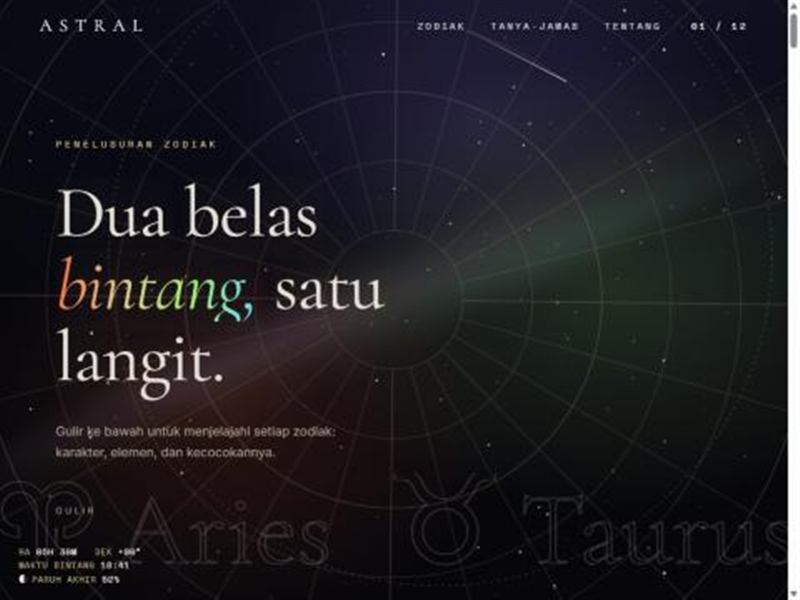

# Astral

Penelusuran dua belas zodiak bergaya observatorium, dengan tanya-jawab.

**Demo:** https://portofolio-jauza-fawaid.netlify.app/ZODIAK/

Situs statis (HTML/CSS/JS). Tanya-jawab punya dua lapis:
1. **AI (opsional)**: `api/ask.js` memanggil Gemini dengan prompt pakar zodiak. Aktif hanya jika di-deploy ke Vercel dengan env `GEMINI_API_KEY` (opsional `GEMINI_MODEL`). Key tidak pernah masuk ke browser.
2. **Bot lokal (cadangan)**: dipakai otomatis kalau AI tidak tersedia (jalan lokal, offline, kuota habis). Data di `knowledge.js` dan `lifestyle.js`. Tanpa API key, tanpa server.

## Menjalankan
- Klik dua kali `index.html`, atau jalankan `py -m http.server 8000` lalu buka http://localhost:8000.

## Deploy (gratis)
- Netlify Drop: seret folder proyek ke https://app.netlify.com/drop
- GitHub Pages: unggah folder ke repository, lalu aktifkan Pages di Settings.
- Vercel: impor repository atau folder statis.

## Struktur
- `index.html` — halaman utama
- `assets/css/main.css` — gaya
- `assets/js/zodiac-data.js` — 12 zodiak dan bentuk rasi bintang
- `assets/js/knowledge.js` — basis pengetahuan (kelebihan, kekurangan, cinta, karier, FAQ, sumber)
- `assets/js/lifestyle.js` — makanan, liburan, fashion, uang, gaya kerja, dan "zodiak paling ..."
- `assets/js/bot.js` — pencari jawaban lokal
- `api/ask.js` — endpoint AI (Vercel Serverless Function)
- `assets/js/fx.js` — pustaka bentuk transisi, tirai antarhalaman, reveal saat scroll, kursor, hero (dipakai semua halaman)
- `assets/js/app.js` — loader, cerita zodiak (transisi per zodiak), pencarian, tanya-jawab
- `site.config.js` — domain, email, ID AdSense (satu-satunya file yang Anda ubah)
- `tools/build-site.js` — membuat ulang artikel, halaman informasi, ads.txt, robots.txt, sitemap.xml
- `templates/index.src.html` — sumber beranda (hasil build menjadi `index.html`)
- `zodiak/*.html`, `about.html`, `contact.html`, `privacy.html`, `terms.html`, `editorial.html`, `404.html` — hasil build, jangan diedit langsung

## Membuat bank tanya-jawab (sekali jalan)
- Windows: klik dua kali `jalankan-generate.bat`, lalu paste GEMINI_API_KEY di jendela terminal.
- macOS/Linux: `bash jalankan-generate.sh`.
- Butuh Node.js (versi LTS). Hasilnya tersimpan di `assets/js/qa-bank.js`.

## Memperbarui isi
Tambah atau ubah data di `knowledge.js` / `lifestyle.js`. Untuk mengubah perilaku AI, edit `SYSTEM_PROMPT` di `api/ask.js`.

## Persiapan AdSense
1. Beli/siapkan domain, lalu isi `siteUrl` dan `email` di `site.config.js`.
2. Jalankan build: klik `jalankan-build.bat` (Windows) atau `bash jalankan-build.sh`. Semua halaman, canonical, sitemap, dan robots ikut diperbarui.
3. Deploy ke domain Anda (Netlify, Vercel, atau GitHub Pages). Pastikan `https://domainanda.com/privacy.html` dan semua artikel bisa dibuka.
4. Daftar di adsense.google.com dengan URL situs. Salin ID penerbit (`ca-pub-...`) ke `publisherId`, build ulang, deploy ulang. Kode AdSense dan `ads.txt` terpasang otomatis.
5. Di AdSense, buka Privacy & messaging dan buat pesan persetujuan cookie untuk EEA/Inggris (gratis dan sudah bersertifikat Google).
6. Tunggu peninjauan. Setelah disetujui, buat unit iklan, isi ID slot di `slots`, lalu build ulang. Di pengaturan Auto ads, matikan format overlay (anchor dan vignette) dan kecualikan beranda agar scroll horizontal tidak terganggu.

Sebelum daftar, pastikan: isi sudah Anda baca ulang, `owner` berisi nama asli, tidak ada teks `contoh-domain` tersisa, dan situs sudah online beberapa hari dengan sedikit kunjungan.

## Transisi (v24)
Cerita zodiak di beranda memakai slide bertumpuk. Setiap zodiak punya bentuk transisi sendiri (lihat tabel `V` di `app.js` dan `SH` di `fx.js`):
Aries ledakan lingkaran · Taurus tirai naik · Gemini dua pita · Cancer gelombang pasang · Leo bintang sinar · Virgo bilah bertingkat · Libra timbangan · Scorpio sabetan · Sagittarius panah · Capricorn puncak gunung · Aquarius arus · Pisces larut.
Huruf nama, latar (bara, lapisan tanah, angin, riak), dan kartu zodiak mengikuti sifat elemennya. Pindah halaman memakai tirai berwarna elemen tujuan. Untuk mengubah satu transisi, edit bentuknya di `SH` (fx.js) dan gerak isinya di `V` (app.js). Semua efek menghormati `prefers-reduced-motion`.

## Transisi bagian bawah (v25)
Setelah cerita zodiak, setiap bagian punya bentuk transisinya sendiri yang digerakkan scroll (daftar di `SECMAP` pada `assets/js/fx.js`):
Semua zodiak = bintang (star) · Temukan zodiakmu = timbangan (scales) · Tanya-Jawab = panah (arrow) · Footer = tanah naik (rise).
Untuk mengganti bentuk, ubah nilainya di `SECMAP`. Bentuk yang tersedia ada di objek `SH`.

## Langit berbintang & kotak angin (v27)
- Latar bintang (`#sky`, dibuat di `assets/js/fx.js`) tampil di semua halaman. Bintang berkedip, bergeser pelan mengikuti scroll, dan sesekali ada bintang jatuh. Latar solid dipindah ke `html` agar bintang terlihat.
- Di setiap slide cerita ada lapisan bintang sendiri (`.sky` di `app.js` dan `main.css`).
- Kotak zodiak (`.sgrid .scard`) terbawa angin dari kiri, melambat, lalu berhenti. Muncul bertahap per baris: `gust` di `fx.js`, keyframe `gust` di `main.css`. Jeda antar baris diatur di `scan()`.

## Generator acak (sampai kuota habis)
- Windows: klik dua kali `jalankan-random.bat`, lalu paste GEMINI_API_KEY. macOS/Linux: `bash jalankan-random.sh`.
- Generator ini mengerjakan yang tertunda dulu, lalu terus membuat pertanyaan acak tentang zodiak (tema gabut, hobi, kebiasaan, percintaan, karier, dan lain-lain) beserta jawabannya. Progres disimpan di `data/qa-generated.json` dan `assets/js/qa-bank.js` ikut diperbarui setiap batch.
- Berhenti sendiri saat kuota harian atau saldo habis. Jalankan lagi nanti untuk melanjutkan. Ctrl+C juga aman.
- Opsi di terminal: `node tools/generate-qa.js --random --token-limit 500000` (berhenti setelah 500 ribu token), `--cycles 10` (berhenti setelah 10 putaran), `--delay 3000` (jeda antar panggilan dalam ms).
- Ekspor bank saja, tanpa memanggil AI: `node tools/generate-qa.js --export`.
